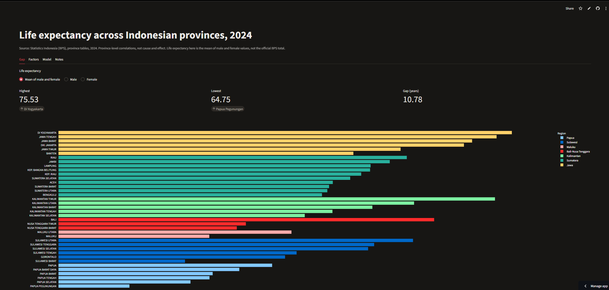

# Life expectancy across Indonesian provinces, 2024

How large is the gap in life expectancy between Indonesian provinces, and which socio-economic factors go with it? A small, pre-planned analysis of 38 provinces with an interactive dashboard.

**[Live dashboard](https://indonesia-life-expectancy-by-province-49pudwdszxhgxkepeuveba.streamlit.app/)** · Analysis plan: [`QUESTIONS.md`](QUESTIONS.md) · Data: [`data_sources.md`](data_sources.md)



## Findings

All numbers are provinces as units (n = 38, year 2024). Life expectancy is the mean of the male and female values from BPS, not the official total.

- **The gap is about 10.8 years**, from 64.8 (Papua Pegunungan) to 75.5 (DI Yogyakarta). Java has the highest regional median (74.3) and Papua the lowest (67.1); three of the five lowest provinces are in Papua.
- **Poverty and sanitation go with life expectancy.** Spearman correlation with poverty is -0.65 (95% bootstrap interval -0.81 to -0.38) and with decent sanitation +0.66 (0.38 to 0.83). Without the six Papua provinces they weaken but remain: -0.44 (-0.71 to -0.07) and +0.53 (0.21 to 0.77).
- **School participation at ages 16-18 shows no clear relation** (+0.21, interval -0.16 to 0.52). log GRDP per capita is unclear with all provinces (+0.33, -0.04 to 0.65) and clearer without Papua (+0.43, 0.02 to 0.73), consistent with mining-heavy Papua provinces having high GRDP and low life expectancy.
- **Considered together, only poverty stands out.** In a regression with poverty, sanitation and school participation (standardised), poverty is -1.47 years per standard deviation (about 6.5 percentage points; interval -2.50 to -0.53). Sanitation (+0.57, -0.66 to 2.47) and school participation (-0.03, -0.90 to 1.17) have wide intervals, partly because sanitation and poverty are strongly related to each other (correlation -0.58).
- **How robust is that?** Without Papua the poverty coefficient shrinks to -0.87 (-1.63 to -0.17), and adding GRDP per capita gives -1.31 with an interval that just reaches zero (-2.30 to 0.01). R2 is 0.52 (adjusted 0.48), an in-sample fit and not predictive accuracy.
- **Java provinces sit above what the model predicts** (DI Yogyakarta +4.4 years, Jawa Tengah +4.1, Jawa Barat +3.2) and Sulawesi Barat sits furthest below (-4.3). This suggests something the model does not measure, possibly health services. That is a guess, not a finding.
- **The female minus male difference is almost constant**, between 3.69 and 4.30 years, so male and female results are practically identical.

## What this does not show

These are province-level correlations, not cause and effect: nothing here shows that reducing poverty raises life expectancy, and a province average does not describe the people living in it. There are only 38 provinces and one year, so the intervals are wide.

## How it was done

- **Plan first.** Questions, variables and methods were fixed in `QUESTIONS.md` before the analysis. Every planned analysis is reported, including weak results.
- **Methods:** Spearman correlations and ordinary least squares with standardised predictors, with 95% percentile intervals from 2,000 bootstrap resamples of provinces (seed 42). Sensitivity checks: without the six Papua provinces, with a fourth predictor (log GRDP), males and females separately, all four school-participation age groups.
- **Disclosure.** A data-quality check printed quick correlations before the plan was locked, so the choice of the three-predictor model is exploratory. The original topic (access to health facilities and workers) was dropped because recent province tables were not available; see `data_sources.md`.
- **Data checks:** 38 provinces in every table with identical names, no missing analysis values, and population-weighted means close to the national rows.

## Limitations

- One year and 38 units; results are sensitive to the six Papua provinces.
- GRDP per capita is distorted by mining; poverty is the simple mean of March and September.
- No health facility, health worker or health expenditure data.
- No out-of-sample validation.

## Run it

```
git clone https://github.com/MLwithDyy/indonesia-life-expectancy-by-province
cd indonesia-life-expectancy-by-province
pip install -r requirements.txt
streamlit run app.py
```

`notebooks/analysis.ipynb` reproduces the cleaning, the analysis and the files in `data/processed/` from the BPS tables listed in `data_sources.md`.

## Repository layout

```
app.py, requirements.txt      Streamlit dashboard
QUESTIONS.md                  analysis plan and deviation log
data_sources.md               sources, cleaning and checks
data/processed/               province_health_2024.csv, corr.csv, model.csv
notebooks/analysis.ipynb      cleaning and analysis
assets/dashboard.png          screenshot
```

## Data and licence

Source: Statistics Indonesia (BPS) statistical tables, accessed on the date given in `data_sources.md`. Raw BPS files are not redistributed here; the repository holds the processed table and the code. Code: add your own licence.
